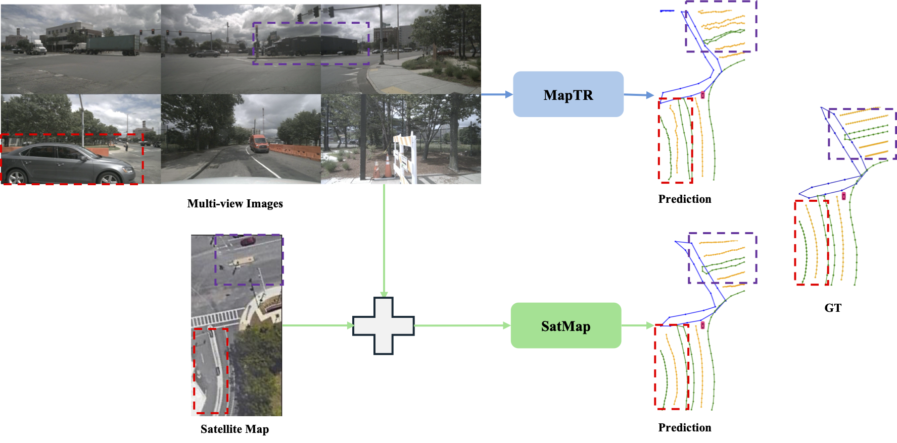
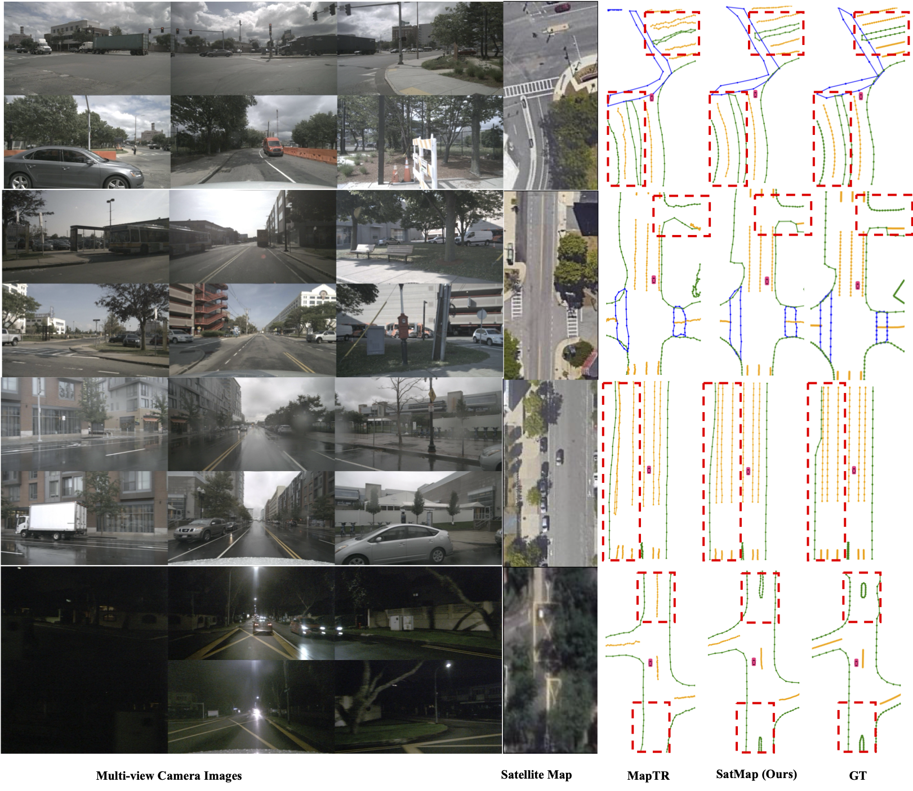

<div align="center">
<h1>SatMap</h1>
<h3>Revisiting Satellite Maps as Prior for Online HD Map Construction</h3>

[Kanak Mazumder](https://arxiv.org/search/cs?searchtype=author&query=Mazumder,+K), [Fabian B. Flohr](https://arxiv.org/search/cs?query=Flohr,+F+B)

[arXiv:2601.10512](https://arxiv.org/abs/2601.10512)

</div>

### News
* **`Mar. 31st, 2026`:** Paper was accepted to [ICPR 2026](https://icpr2026.org/).

## Introduction


Online high-definition (HD) map construction is an essential part of safe and robust end-to-end autonomous driving (AD) pipeline. Onboard camera-based approaches suffer from limited depth perception and degraded accuracy due to occlusion. In this work, we propose SatMap, an online vectorized HD map estimation method, which integrates satellite map with multi-view camera observations and directly predicts vectorized HD map for downstream prediction and planning modules. Our method leverages lane-level semantics and texture from satellite imagery captured from Bird’s Eye View (BEV) perspective as a global prior, effectively mitigating depth ambiguity and occlusion. In our experiments on nuScenes dataset, SatMap achieves 34.8% mAP performance improvement over Camera-only baseline and 8.5% mAP improvement over Camera-LiDAR fusion baseline. Moreover, we evaluate our model in long range and adverse weather conditions to demonstrate the advantages of using satellite prior map.

## Models

| Method | Backbone | Lr Schd | mAP| FPS|
| :---: | :---: | :---: | :---: | :---: 
| SatMap | R50 | 24ep | 67.8 | 19.8| 
| SatMap | R50 | 110ep | 72.7 | 19.8|

## Getting Started
- [Installation](docs/install.md)
- [Prepare Dataset](docs/prepare_dataset.md)
- [Train and Eval](docs/train_eval.md)
<!-- - [Visualization](docs/visualization.md) -->

## Qualitative results on nuScenes val split


## Acknowledgements
SatMap is based on [mmdetection3d](https://github.com/open-mmlab/mmdetection3d). It is also greatly inspired by the following outstanding contributions to the open-source community: [MapTR](https://github.com/hustvl/MapTR), [SatforHDMap](https://github.com/xjtu-cs-gao/SatforHDMap), [BEVFusion](https://github.com/mit-han-lab/bevfusion), [GKT](https://github.com/hustvl/GKT).

## Citation
If you use this code or this paper in your research, please cite:
```bibtex
@article{mazumder2026satmap,
  title={SatMap: Revisiting Satellite Maps as Prior for Online HD Map Construction},
  author={Mazumder, Kanak and Flohr, Fabian B},
  journal={arXiv preprint arXiv:2601.10512},
  year={2026}
}
```
